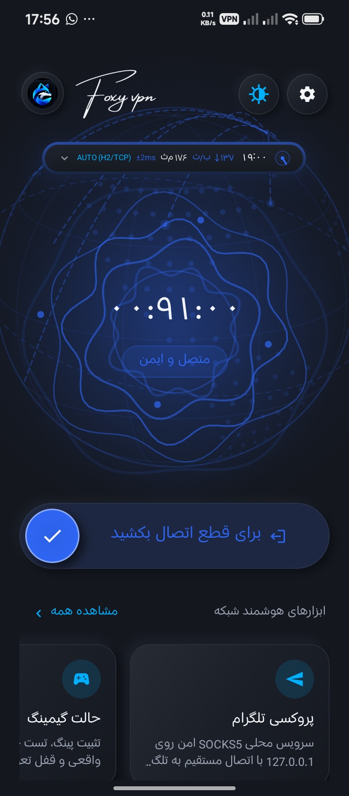
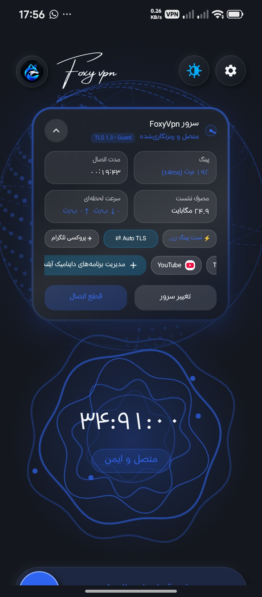
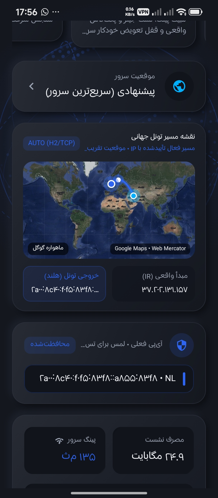
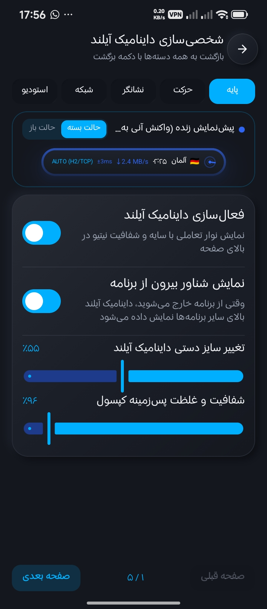
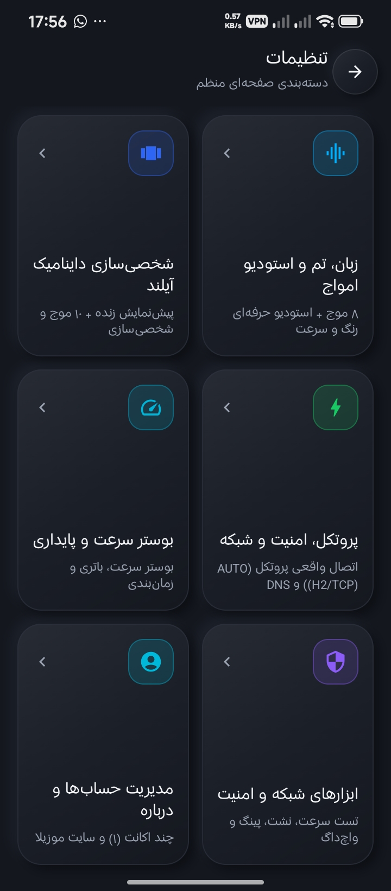

<div align="center">

# FoxyVPN — Cyber Blue & Minimal Edition (v1.0.8)

<p align="center">
  
</p>


*FoxyVPN keeps its Firefox-account sign-in and native Kotlin/Jetpack Compose UI, while the embedded Firefox Go core routes VPN traffic through Firefox VPN's edge relays over HTTP/3/QUIC with HTTP/2 fallback. The app includes a Minimalist Obsidian Black, Pure White & Electric Blue UI, 50+ High-FPS Animations, Expanded Dynamic Island & Pro Wave Studio, 3 Multi-Size Live Home Widgets, Interactive Zoomable Global Route Map, Quick Settings Control Center Tile, loopback Telegram SOCKS5 access, and One-Tap Sanitized Diagnostics.*

</div>

---

## 📸 Official App Screenshots

<p align="center">
  
  
  
  
  
</p>

---

## 📦 Multi-Architecture & Universal APK Builds

The embedded Firefox Go core is built for all Android CPU architectures. The build produces **per-ABI split APKs** and a **Universal All-in-One APK**:

| APK Build Variant | Target CPU Architecture | Recommended Devices |
| :--- | :--- | :--- |
| `FoxyVPN-Neu-universal-release.apk` | **Universal (`arm64-v8a`, `armeabi-v7a`, `x86_64`, `x86`)** | All Android phones, tablets, Chromebooks & emulators |
| `FoxyVPN-Neu-arm64-v8a-release.apk` | **64-bit ARM (`arm64-v8a`)** | Modern Android smartphones & tablets (Android 10–15) |
| `FoxyVPN-Neu-armeabi-v7a-release.apk` | **32-bit ARM (`armeabi-v7a`)** | Older 32-bit ARM phones, Android TV boxes & routers |
| `FoxyVPN-Neu-x86_64-release.apk` | **64-bit Intel / AMD (`x86_64`)** | Chromebooks, Android Studio / PC emulators |
| `FoxyVPN-Neu-x86-release.apk` | **32-bit Intel (`x86`)** | Legacy x86 tablets & emulators |

After installing the pinned Go/gomobile, Android SDK/NDK, and Gradle prerequisites listed below, build and test all CPU-specific APKs plus the Universal APK from source:
```bash
./scripts/build-android.sh
```

---

## ✨ Key Capabilities & Real Features

### 1. Minimalist Cyber-Blue Palette & Perfect Circle Icon System
- **Official Circular Blue & White Fox Identity**: Unified across all `mipmap-*` launcher densities, adaptive icons, foreground notification status icon (`@drawable/ic_foxy_status_round`), Quick Settings Control Center tile, and home launcher widget.
- **Perfect Circle (`CircleShape`) Geometry**: Every icon button, status badge, settings category emblem, and app dock avatar renders as a seamless circle without sharp corners or inner squircle artifacts.
- **Minimalist Obsidian Black, Crisp White & Modern Blue Palette**: Deep Obsidian Night (`#0A0D14`) and Pure Alabaster Day (`#F4F7FC`) paired with Electric Sapphire (`#0066FF`), Arctic Cyan (`#00C8FF`), and Sky Ice (`#38BDF8`).

### 2. 50+ High-FPS Animations & Motion Physics
- **12 Hero Wave Styles**: Including *Cyber Fox Aurora*, *Orbital Gyroscope*, *Crystal Resonance*, *Gravity Singularity*, *Quantum Plasma*, *Cyber Hexagon*, and *Sonar Radar*.
- **14 Dynamic Island Motion Physics & 14 LED Border Chasers**: Including *Cryo Frost Glide*, *Electric Cobalt Flux*, *Magnetic Snap*, *Liquid Morph*, and *Turbo Elastic*.
- **12 State-Aware Dynamic Island Status Indicators**: *Fox Cyber Core*, *Quantum Gyro*, *Cryo Matrix*, *Sonar Sweep*, *Plasma Shield*, *Radar Lock*, and *Equalizer*.

### 3. Expanded Dynamic Island & Pro Wave Studio
- **Synchronized In-App & System Overlay Island**: Unified spring-physics morphing (`dampingRatio` & `stiffness` customizable in real time) both inside the app and as a floating overlay (`TYPE_APPLICATION_OVERLAY`) outside the app.
- **4 Surface Material Modes**: *Obsidian Glass*, *Cryo Frosted*, *Deep Neon Blue*, and *Pure Minimal*.
- **4-Action Quick Control Deck & Live Interactive Style Deck**: Instant one-tap access to Telegram Proxy, Auto TLS Protocol Switcher, Live Ping Probe, and Leak Test, plus live in-island indicator, motion, and wave cycling.
- **Pro Wave Studio**: 10 acoustic wave styles with independent bar count (`4–16`), stroke thickness (`2–6 dp`), speed, sensitivity, amplitude, phase shift, glow intensity, and 7 color modes.

### 4. Three Multi-Size Animated Widgets & Quick Settings Tile
- **3 In-App Live Interactive Widgets**:
  - **1x1 Compact Row**: *Live Cipher Core* (orbital rotating shield + one-tap protocol switch) & *Sonar Ping Radar* (sweeping radar beam + instant TCP latency test).
  - **2x1 Medium Matrix**: *Live Traffic Spectrum* with an 18-bar real-time acoustic throughput equalizer.
  - **2x2 Large Command Hub**: *Foxy Cyber Command Hub* with circular Fox emblem, live uptime telemetry, and quick-launch pills for Gaming, Telegram Proxy, and Leak Test.
- **Android Quick Settings Tile (`QuickConnectTileService`)**: Instant one-tap VPN toggle from the Android Control Center with the official circular Fox icon and live server/ping subtitle.

### 5. Interactive Zoomable Global Tunnel Route Map
- **Interactive Zoom & Destination Focus**: Smooth spring-animated **Zoom-In (`+`), Zoom-Out (`−`), and Exit Country Focus (`🎯`)** (`1.0x` to `3.4x`) over Google Maps Satellite/Map tiles and Web Mercator vector graticules.
- **Vector Country Territory Borders & Geodesic Radar Rings**: Highlights origin and destination country boundaries with bidirectional animated packet streams along the geodesic Bezier arc.

### 6. Firefox VPN Core, Telegram SOCKS5 Proxy & Security Audit
- **Supported Core Transports**: Firefox core HTTP/3/QUIC with native HTTP/2 fallback; the UI displays the transport actually negotiated by the core.
- **Loopback Telegram SOCKS5 Proxy**: Firefox core's `127.0.0.1:<port>` SOCKS5/HTTP listener with Foxy's `tg://socks` deep-link integration; optional separate HTTP port is forwarded locally.
- **Real In-Tunnel Leak Audit & Sanitized Diagnostics**: Compares direct ISP IP vs proxied exit IP, verifies DoH DNS resolution, and generates a one-tap sanitized diagnostic report.

---

## 📄 License
Licensed under the [MIT License](LICENSE).


## Firefox Go core integration

The Android VPN service now uses the embedded `firefox-core` Go module as its sole VPN dataplane; the old HEV native tunnel, Kotlin SOCKS/HTTP upstream engine, and Netty H2 transport are removed. Foxy's existing Compose UI, Firefox-account sign-in, and encrypted `TokenStore` remain in place; a narrow in-process gomobile adapter reconciles account tokens and deletion state, chooses the active account, applies the selected country, and transfers the Android TUN descriptor to the core. Credentials are not placed in the dashboard HTTP API or logs. The local proxy is loopback-only and uses Foxy's SOCKS5 port; Firefox core accepts both SOCKS5 and HTTP proxy requests on that same port. Network Tools counters are sourced from Firefox core's connection tracker.

Build the app from source with `scripts/build-android.sh` after installing Go 1.27.2, gomobile/gobind at the versions in that script, Gradle 8.10.2, Android platform/build tools 35, and NDK 30. The script runs all Go core tests and `go vet`, produces `app/libs/firefox-core.aar` for Android ABIs, and assembles debug/release APKs. CI performs the same core test/AAR step before Gradle packaging.

The H3/QUIC option now uses Firefox core's native transport, and the UI reads the core's live transport state so its native H3-to-H2 fallback is reflected accurately. Destinations map to country selection (the core chooses the actual relay host), not a pinned Foxy host/port. The legacy HTTP/1.1 TLS-fragmentation option is disabled because it belongs to Foxy's replaced tunnel engine. Firefox core serves SOCKS5 and HTTP proxy traffic on one loopback-only port; when Foxy's optional separate HTTP port is enabled, a small local TCP forwarder maps that port to the core listener. Remote/LAN proxy binding is intentionally not enabled to avoid exposing an unauthenticated proxy.

The Foxy app source retains its MIT notice in `LICENSE`. The embedded Firefox core is GPLv3; its complete license is included at `firefox-core/LICENSE`. Keep both notices and the corresponding source when redistributing the merged application.
